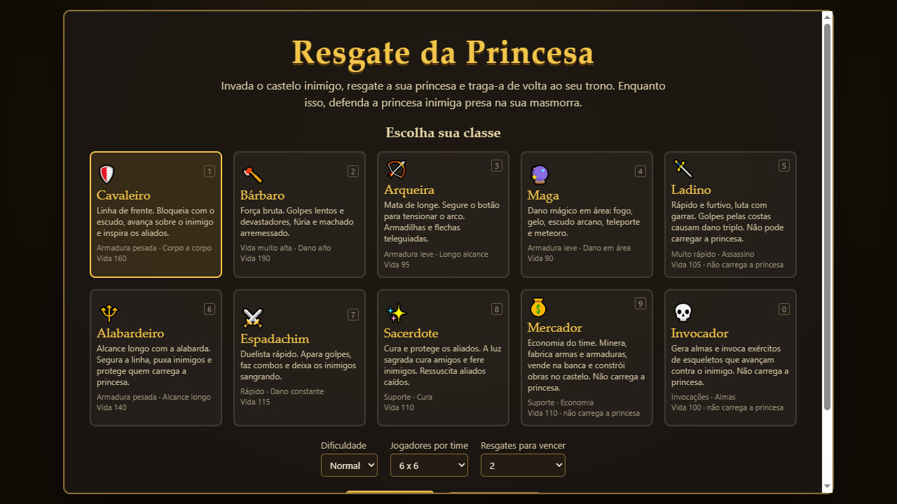
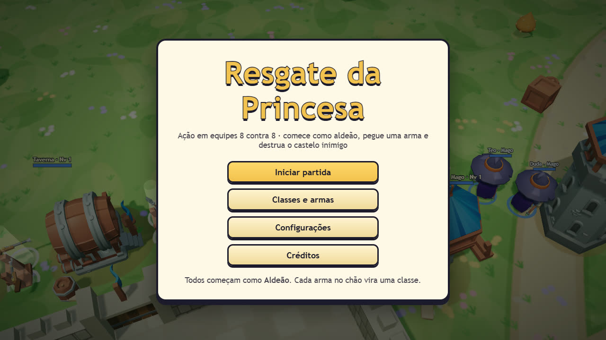
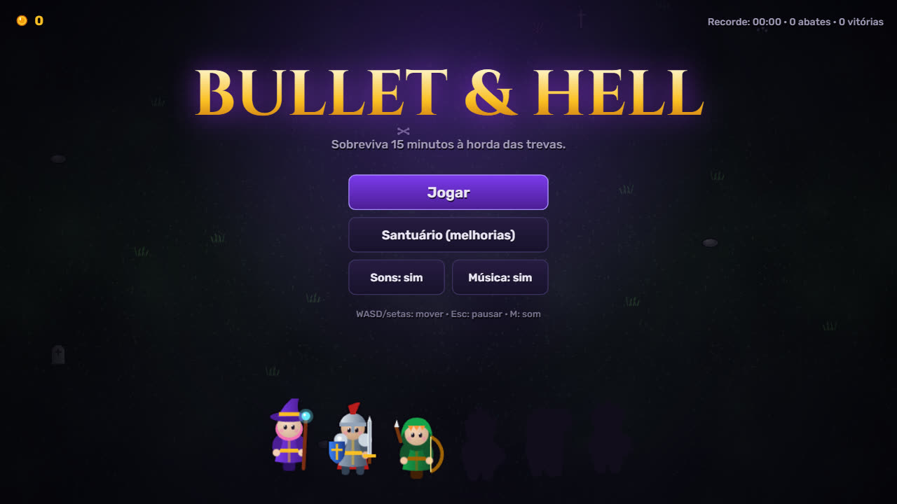
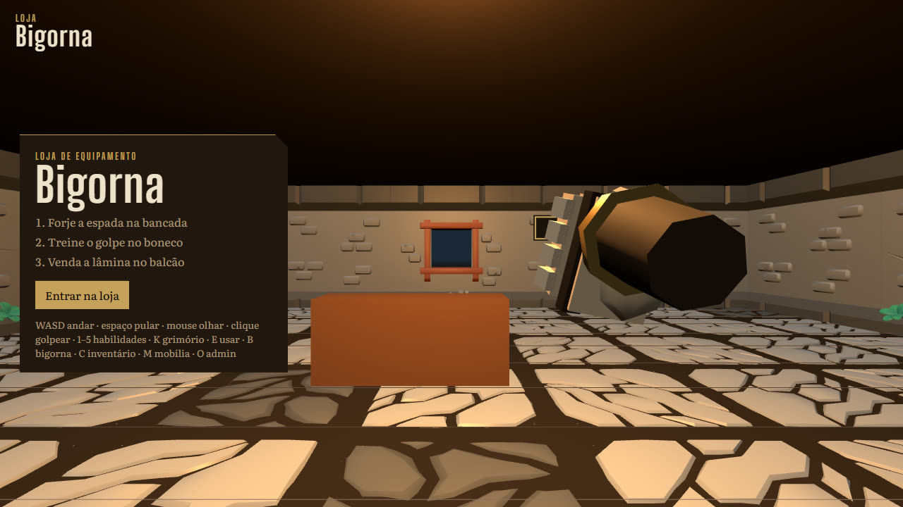
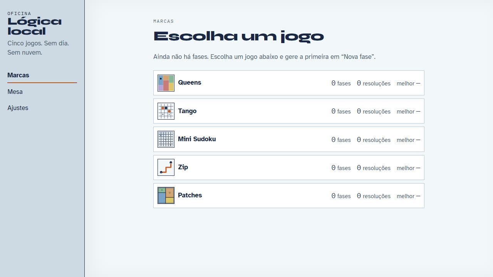

# Jogos

Jogos que fiz para rodar direto no navegador, sem instalação nem conta. [← Voltar ao perfil](README.md)

**[Resgate da Princesa](#resgate-da-princesa)** · **[Resgate da Princesa 2](#resgate-da-princesa-2)** · **[Bullet & Hell](#bullet--hell)** · **[Bigorna](#bigorna-game-shop-3d)** · **[Oficina de lógica](#oficina-de-lógica)**

| Jogo | Gênero | Tecnologia | Onde jogar |
| --- | --- | --- | --- |
| [Resgate da Princesa](#resgate-da-princesa) | Ação em primeira pessoa, times | JavaScript, Three.js | [Online](https://gabrieltrentino.github.io/Rescue-Princess/) |
| [Resgate da Princesa 2](#resgate-da-princesa-2) | Ação isométrica 8 contra 8 | JavaScript, Three.js | Localmente |
| [Bullet & Hell](#bullet--hell) | Sobrevivência com armas automáticas | JavaScript, Canvas | Localmente |
| [Bigorna](#bigorna-game-shop-3d) | Loja de RPG, crafting e combate | TypeScript, Three.js, Vite | Localmente |
| [Oficina de lógica](#oficina-de-lógica) | Puzzles de lógica | TypeScript, React, Vite | [Online](https://gabrieltrentino.github.io/linkedin-games-solver-generator/) |

---

## Resgate da Princesa

[Repositório](https://github.com/GabrielTrentino/Rescue-Princess) · [Jogar online](https://gabrieltrentino.github.io/Rescue-Princess/)

Ação em **primeira pessoa** inspirada em *Fat Princess*, feita com **Three.js** e os modelos gratuitos KayKit (CC0). Dois castelos, um em cada ponta do mapa: invada o castelo inimigo, carregue a sua princesa de volta ao trono e impeça que o outro time resgate a dele.

<table>
  <tr>
    <td width="50%"></td>
    <td width="50%"></td>
  </tr>
  <tr>
    <td align="center">Escolha entre 10 classes</td>
    <td align="center">Início de partida no castelo azul</td>
  </tr>
</table>

- **10 classes** (Cavaleiro, Bárbaro, Arqueira, Maga, Ladino, Alabardeiro, Espadachim, Sacerdote, Mercador e Invocador), cada uma com ataque base, botão direito e 5 skills.
- Progressão do nível 1 ao 10, com 2 perks por skill e evolução para o Nível II.
- Economia de ouro, equipamentos, banquete, canhão e mercador.
- Controles: WASD e mouse, Shift corre, 1 a 5 usam as skills, E interage, K abre os perks e I a mochila.

---

## Resgate da Princesa 2

[Repositório](https://github.com/GabrielTrentino/Rescue-Princess-2) · Rodar com `npm start` e abrir `http://localhost:8000`

Releitura em **3D isométrico**, 8 contra 8. Todo mundo começa como **Aldeão** e vira uma classe ao pegar a arma que a construção do time fabrica. Quem morre derruba a arma no chão, e qualquer um pode pegá-la.

<table>
  <tr>
    <td width="50%"></td>
    <td width="50%"></td>
  </tr>
  <tr>
    <td align="center">Menu sobre o mapa</td>
    <td align="center">Time azul reunido no pátio do castelo</td>
  </tr>
</table>

- Construções que fabricam armas: Quartel, Serraria, Torre do Mago, Campo de Tiro, Taverna, Ferraria e Mina.
- Melhorias pagas com o ouro da equipe, muralhas com pontos fracos e ruínas que o Engenheiro reconstrói.
- Habilidades sem recarga: cada classe gasta uma barra própria (Estamina, Fúria, Mana, Foco...).
- Controles: WASD relativo à câmera, mouse para mirar, 1 a 5 para habilidades, F pega arma ou princesa, G melhora construção.

---

## Bullet & Hell

[Repositório](https://github.com/GabrielTrentino/bullet-and-hell) · Rodar com qualquer servidor estático (`python -m http.server 8000`)

Sobrevivência com armas automáticas, inspirada em *Vampire Survivors*. Sobreviva 15 minutos à horda de mortos-vivos e derrote o Rei Lich ao amanhecer. JavaScript puro e canvas, sem dependências: sprites, cenário, efeitos sonoros e música são gerados por código.

<table>
  <tr>
    <td width="50%"></td>
    <td width="50%"></td>
  </tr>
  <tr>
    <td align="center">Tela de título</td>
    <td align="center">Minuto 8, com O Ceifador em campo</td>
  </tr>
</table>

- **6 heróis**, **9 armas** com 8 níveis e **9 evoluções** (Bola de Fogo + Vela Eterna vira Chuva de Meteoros).
- 9 tipos de inimigo, elites com baús e 3 chefes com padrões de projéteis.
- Santuário com 10 melhorias permanentes, progresso salvo no navegador.
- Controles: WASD ou setas no teclado, ou arrastar na tela do celular. As armas atacam sozinhas.

---

## Bigorna (game-shop-3d)

[Repositório](https://github.com/GabrielTrentino/game-shop-3d) · Rodar com `npm install` e `npm run dev`

Você é dono de uma **loja de equipamentos de RPG** em 3D. O ciclo é lutar, obter materiais, forjar na bigorna, vender no balcão ou equipar, e voltar a lutar. Feito em TypeScript com Three.js e Vite.

<table>
  <tr>
    <td width="50%"></td>
    <td width="50%"></td>
  </tr>
  <tr>
    <td align="center">Tutorial: forjar, treinar e vender</td>
    <td align="center">Dentro da loja, com HUD e barra de habilidades</td>
  </tr>
</table>

- Crafting de armas (espada, adaga, cajado) e armaduras em 5 tiers, com raridade e conjuntos.
- Clientes com pedidos e preço calculado por categoria, tier, raridade e conjunto.
- Combate em primeira pessoa em arenas separadas da loja, com loot que alimenta o craft.
- Controles: WASD anda, mouse olha, clique golpeia, 1 a 5 habilidades, E usa, B abre a bigorna e C o inventário.

---

## Oficina de lógica

[Repositório](https://github.com/GabrielTrentino/linkedin-games-solver-generator) · [Jogar online](https://gabrieltrentino.github.io/linkedin-games-solver-generator/)

Gerador e jogador de puzzles no estilo dos jogos de lógica do LinkedIn, **100% no navegador**. É uma implementação independente das mesmas regras, sem copiar tabuleiros oficiais, pensada para treino ilimitado e para rejogar a mesma fase.

<table>
  <tr>
    <td width="50%"></td>
    <td width="50%"></td>
  </tr>
  <tr>
    <td align="center">Os cinco jogos</td>
    <td align="center">Queens gerado na dificuldade média</td>
  </tr>
</table>

- 5 jogos: Queens, Tango, Mini Sudoku, Zip e Patches.
- Fases geradas em Web Worker nas dificuldades fácil, média e difícil, reproduzíveis pela seed.
- Cronômetro, desfazer, caderno por jogo com gráfico de tempos e exportação do progresso em JSON.
- Tudo salvo no IndexedDB do navegador, sem conta e sem servidor.

---

[← Voltar ao perfil](README.md)
