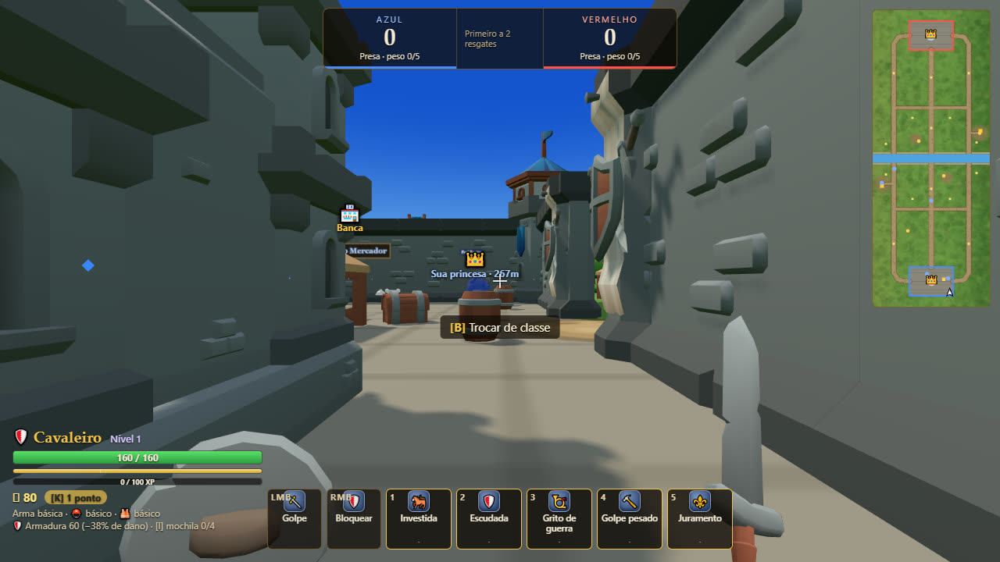
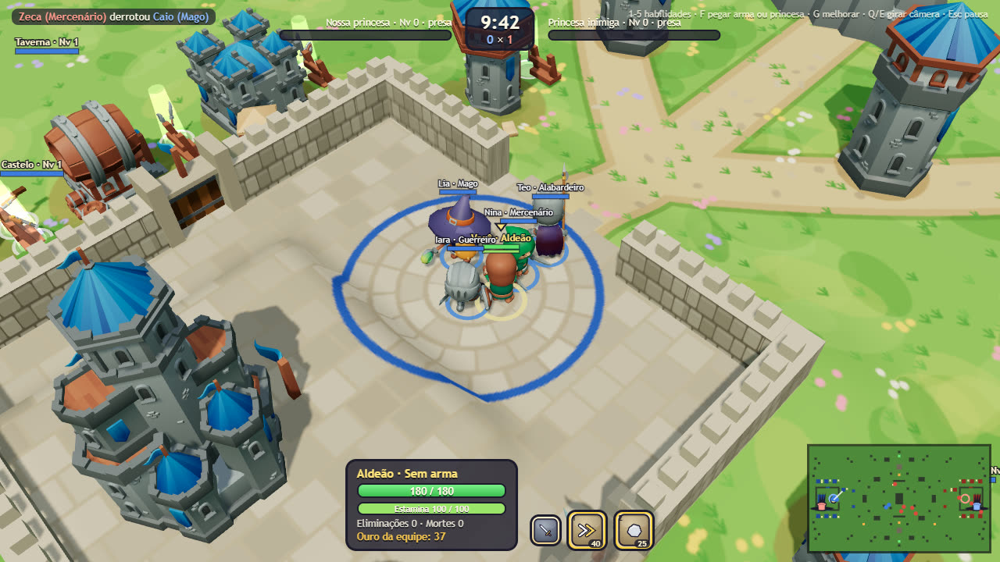
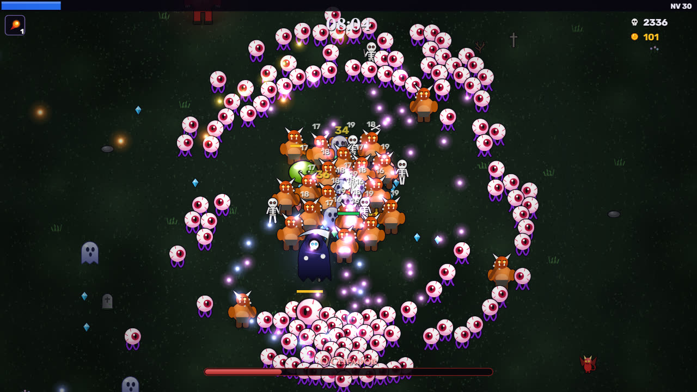
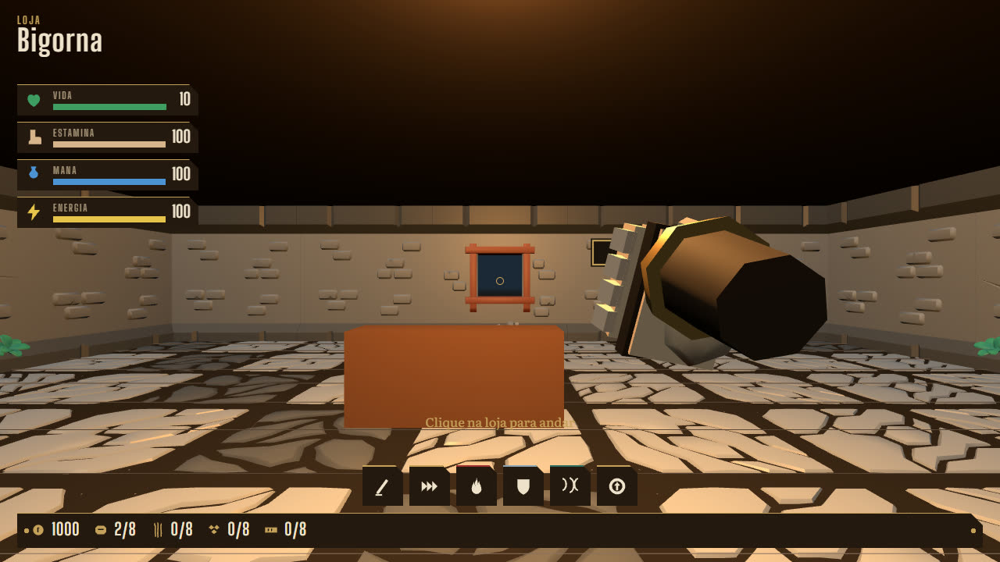
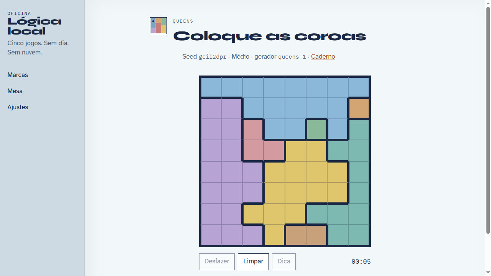

# Gabriel Trentino Fróes

**Data Engineer** · Goiânia, GO

Data Engineer com cerca de 7 anos em dados e automação. Construo pipelines ETL/ELT, Data Lakes e camadas analíticas com **Python**, **SQL**, **GCP**, **BigQuery** e **Airflow**, da ingestão à qualidade dos dados e ao consumo. Nas horas vagas, faço jogos que rodam direto no navegador.

---

## Stack

| Área | Tecnologias |
| --- | --- |
| Linguagens | Python, SQL, PL/SQL, Java, C#, JavaScript, TypeScript |
| Engenharia de dados | Airflow, Cloud Composer, PySpark, Spark, dbt, Databricks |
| Arquitetura | ETL / ELT, Data Lake, Medallion (Raw → Trusted → Refined), Data Quality, IAM, Governança |
| Cloud | GCP (BigQuery, Dataflow, Pub/Sub, Cloud Functions, Cloud SQL, Cloud Scheduler), Azure, Microsoft Fabric |
| Ferramentas | Git, GitHub, Bitbucket, Power BI, Oracle, CI/CD, JIRA |

Atuação em seguros, telecom, energia e distribuição: pipelines em produção, modelagem, otimização de consultas e automação.

---

## Projetos de dados e automação

<table>
  <tr>
    <td width="50%" valign="top">
      <h3><a href="https://github.com/GabrielTrentino/anp-data-atlas">anp-data-atlas</a></h3>
      
Atlas dos dados abertos da ANP: documentação em Markdown, dicionários e pipelines raw → trusted → refined prontos para reuso em outros projetos.

      
<code>Python</code> <code>Data Lake</code> <code>documentação</code>

    </td>
    <td width="50%" valign="top">
      <h3><a href="https://github.com/GabrielTrentino/anp-fuel-analytics">anp-fuel-analytics</a></h3>
      
Pipeline e análises sobre combustíveis, capacidade de armazenagem e derivados. Camadas Medallion em Python + SQL/DuckDB, com qualidade de dados alimentando o atlas.

      
<code>Python</code> <code>SQL</code> <code>DuckDB</code> <code>Medallion</code>

    </td>
  </tr>
  <tr>
    <td width="50%" valign="top">
      <h3><a href="https://github.com/GabrielTrentino/AudioTranscriber">AudioTranscriber</a></h3>
      
Transcrição de áudio e vídeo para texto com faster-whisper: GUI, CLI e API (FastAPI), com timestamps e identificação de falantes.

      
<code>Python</code> <code>Whisper</code> <code>FastAPI</code>

    </td>
    <td width="50%" valign="top">
      <h3><a href="https://github.com/GabrielTrentino/JobScout">JobScout</a></h3>
      
Lê o currículo (PDF ou DOCX) localmente, busca vagas recentes compatíveis e registra quais você visitou, em quais se candidatou e o link de cada uma.

      
<code>Python</code> <code>automação</code> <code>IA opcional</code>

    </td>
  </tr>
  <tr>
    <td width="50%" valign="top">
      <h3>Winthor ERP</h3>
      
Data Lake e Power BI sobre Winthor/TOTVS: integração, automação, IAM, governança e IA/RAG sobre dados estruturados.

      
<code>ETL</code> <code>IAM</code> <code>governança</code>

    </td>
    <td width="50%" valign="top">
      <h3><a href="https://github.com/GabrielTrentino/docker-zoomcamp-m1">docker-zoomcamp-m1</a></h3>
      
Módulo 1 do Data Engineering Zoomcamp: pipeline em Python com pandas e PyArrow, empacotado com Docker e uv.

      
<code>Docker</code> <code>Python</code> <code>pandas</code>

    </td>
  </tr>
</table>

---

## Jogos

Jogos feitos para rodar no navegador, sem instalação. Detalhes, controles e prints de cada um estão em **[JOGOS.md](JOGOS.md)**.

<table>
  <tr>
    <td width="33%" valign="top">
      
      <b><a href="https://github.com/GabrielTrentino/Rescue-Princess">Resgate da Princesa</a></b> 
      Ação em primeira pessoa com 10 classes, inspirado em <i>Fat Princess</i>. <a href="https://gabrieltrentino.github.io/Rescue-Princess/">Jogar online</a>.
    </td>
    <td width="33%" valign="top">
      
      <b><a href="https://github.com/GabrielTrentino/Rescue-Princess-2">Resgate da Princesa 2</a></b> 
      Versão isométrica 8 contra 8: todos começam como aldeão e viram classe ao pegar uma arma.
    </td>
    <td width="33%" valign="top">
      
      <b><a href="https://github.com/GabrielTrentino/bullet-and-hell">Bullet &amp; Hell</a></b> 
      Sobrevivência com armas automáticas no estilo <i>Vampire Survivors</i>, tudo gerado por código.
    </td>
  </tr>
  <tr>
    <td width="33%" valign="top">
      
      <b><a href="https://github.com/GabrielTrentino/game-shop-3d">Bigorna (game-shop-3d)</a></b> 
      Loja de equipamentos em 3D: forje, venda no balcão e lute para conseguir materiais.
    </td>
    <td width="33%" valign="top">
      
      <b><a href="https://github.com/GabrielTrentino/linkedin-games-solver-generator">Oficina de lógica</a></b> 
      Gerador de puzzles no estilo dos jogos do LinkedIn (Queens, Tango, Zip...). <a href="https://gabrieltrentino.github.io/linkedin-games-solver-generator/">Jogar online</a>.
    </td>
    <td width="33%" valign="top" align="center">
        
      <b><a href="JOGOS.md">Ver todos os jogos →</a></b>
    </td>
  </tr>
</table>

---

## Estudos e cursos

- [DataScienceEmProducao](https://github.com/GabrielTrentino/DataScienceEmProducao): previsão de vendas de lojas em notebooks, da análise exploratória à modelagem.
- [PLN-BERT](https://github.com/GabrielTrentino/PLN-BERT): processamento de linguagem natural com BERT.
- [Competicoes](https://github.com/GabrielTrentino/Competicoes): soluções de competições do Kaggle e outros datasets.
- [WebScraping](https://github.com/GabrielTrentino/WebScraping): coletas de dados com web scraping.
- [TCC](https://github.com/GabrielTrentino/TCC), [Bootcamps-Masterclass](https://github.com/GabrielTrentino/Bootcamps-Masterclass), [Projetos-de-Cursos](https://github.com/GabrielTrentino/Projetos-de-Cursos) e [Python_Basico](https://github.com/GabrielTrentino/Python_Basico).

---

## Contato

- [LinkedIn](https://www.linkedin.com/in/gabriel-trentino-froes-415558144/)
- [GitHub](https://github.com/GabrielTrentino)
- Portfólio: em breve
